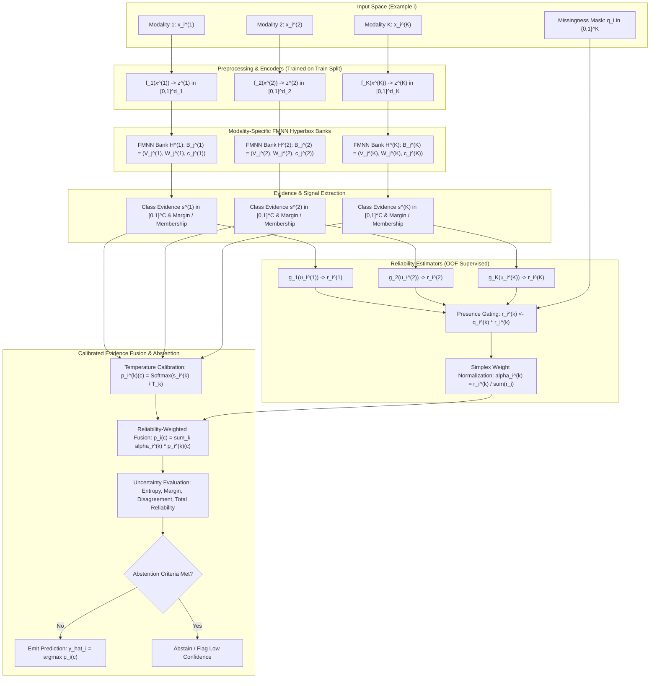
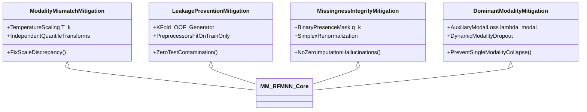

# MM-RFMNN: Multimodal Reliability-Aware Fuzzy Min-Max Neural Network
## Comprehensive Algorithm Blueprint, Research Methodology & Implementation Plan

---

### Executive Overview

The **Multimodal Reliability-Aware Fuzzy Min-Max Neural Network (MM-RFMNN)** solves a fundamental failure mode in contemporary multimodal learning: **catastrophic reliance on corrupted, uninformative, or missing modalities**. While conventional deep early/late fusion models collapse when one channel is degraded, MM-RFMNN introduces:
1. **Modality-Specific Hyperbox Quantization**: Decoupled geometric representation spaces preserving individual modality semantics.
2. **Leakage-Free Instance Reliability Estimation**: Out-of-fold supervised meta-estimators scoring confidence, margin, and data quality.
3. **Evidence-Calibrated Simplex Fusion**: Temperature-calibrated arithmetic and logarithmic fusion with zero-imputation-free missingness masking.
4. **Selective Classification & Abstention**: Multi-criteria uncertainty bounds delivering certifiable risk-coverage guarantees.

---

## 1. System Architecture & Information Flow

The MM-RFMNN pipeline processes $K$ heterogeneous modalities through a decoupled, two-stage geometric and probabilistic network.



---

## 2. Mathematical Formulation

### 2.1 Modality Encoding & Normalization
For $K$ modalities, each input $x_i^{(k)} \in \mathbb{R}^{d_k}$ is preprocessed or encoded to $z_i^{(k)} = f_k(x_i^{(k)}) \in [0, 1]^{d_k}$. 
To strictly prevent test-set leakage, min-max bounds or quantile scaling parameters are fitted exclusively on the training partition:
$$z_{ir}^{(k)} = \text{clip}\left(\frac{x_{ir}^{(k)} - \min_{j \in \mathcal{D}_{\text{train}}} x_{jr}^{(k)}}{\max_{j \in \mathcal{D}_{\text{train}}} x_{jr}^{(k)} - \min_{j \in \mathcal{D}_{\text{train}}} x_{jr}^{(k)} + \epsilon_{\text{scale}}}, 0, 1\right)$$

### 2.2 Hyperbox Representation & Fuzzy Membership
Each modality maintains a dedicated hyperbox bank:
$$\mathcal{H}^{(k)} = \{B_j^{(k)} = (V_j^{(k)}, W_j^{(k)}, c_j^{(k)}) \mid j = 1, \dots, M_k\}$$
where $V_j^{(k)} \in [0, 1]^{d_k}$ is the min-point, $W_j^{(k)} \in [0, 1]^{d_k}$ is the max-point, and $c_j^{(k)} \in \{1, \dots, C\}$ is the class label.

The dimension-wise outside distance of point $z$ to hyperbox $B_j^{(k)}$ is:
$$d_{jr}^{(k)}(z) = \max(0, \, v_{jr}^{(k)} - z_r, \, z_r - w_{jr}^{(k)})$$
The total Manhattan outside distance is:
$$D_j^{(k)}(z) = \sum_{r=1}^{d_k} d_{jr}^{(k)}(z)$$
The continuous fuzzy membership function is:
$$\mu_j^{(k)}(z) = \exp\left(-\gamma_k \cdot D_j^{(k)}(z)\right), \quad \gamma_k > 0$$
where $\gamma_k$ is the modality sensitivity parameter. Inside the box, $D_j^{(k)}(z) = 0 \implies \mu_j^{(k)}(z) = 1$. Outside the box, membership decays exponentially with Manhattan distance.

Class-level evidence for class $c \in \{1, \dots, C\}$ is the supremum across matching hyperboxes:
$$s_c^{(k)}(z) = \max_{j : c_j^{(k)} = c} \mu_j^{(k)}(z)$$
If no hyperbox exists for class $c$ in modality $k$, $s_c^{(k)}(z) = 0$.

### 2.3 Feature-State Representation for Reliability Estimation
For example $i$ and modality $k$, the meta-feature vector $u_i^{(k)}$ captures four orthogonal reliability facets:
1. **Top Membership Strength**:
   $$m_i^{(k)} = \max_{c \in \{1, \dots, C\}} s_c^{(k)}(z_i^{(k)}) \in [0, 1]$$
2. **Class Margin (Separation Confidence)**:
   $$\Delta_i^{(k)} = s_{(1)}^{(k)}(z_i^{(k)}) - s_{(2)}^{(k)}(z_i^{(k)}) \in [0, 1]$$
   where $s_{(1)}^{(k)}$ and $s_{(2)}^{(k)}$ are the highest and second-highest class evidence scores.
3. **Hyperbox Distance Sparsity**:
   $$\delta_{\min, i}^{(k)} = \min_{j} D_j^{(k)}(z_i^{(k)})$$
4. **Input Quality Indicators** $Q_i^{(k)}$ (if present at test time, e.g., missing feature ratio, sensor variance, noise indicator):
   $$u_i^{(k)} = \left[m_i^{(k)}, \, \Delta_i^{(k)}, \, \exp(-\delta_{\min, i}^{(k)}), \, Q_i^{(k)}\right]^T \in \mathbb{R}^{d_u}$$

### 2.4 Reliability Meta-Estimator
Reliability $r_i^{(k)} \in (0, 1)$ is modeled via a parameterized function $g_{\phi_k}$:
$$r_i^{(k)} = \sigma(g_{\phi_k}(u_i^{(k)})) = \frac{1}{1 + \exp\left(-(\mathbf{w}_k^T u_i^{(k)} + b_k)\right)}$$
*(For non-linear relationships, $g_{\phi_k}$ is a 2-layer MLP with ELU activations and LayerNorm).*

### 2.5 Leakage-Free Out-Of-Fold (OOF) Target Generation
A critical vulnerability of reliability modeling is training on in-sample predictions: because training error is artificially low, the reliability model becomes overconfident and fails to penalize subtle test corruptions.
To eliminate this leakage:
1. Partition training set $\mathcal{D}_{\text{train}}$ into $V$ folds ($V=5$).
2. For each fold $v \in \{1, \dots, V\}$, train base FMNNs on $\mathcal{D}_{\text{train}} \setminus \mathcal{D}_v$.
3. Compute out-of-fold class predictions on $\mathcal{D}_v$:
   $$\hat{y}_{i, \text{OOF}}^{(k)} = \arg\max_{c} s_c^{(k), (-v)}(z_i^{(k)}), \quad i \in \mathcal{D}_v$$
4. Define the binary ground-truth correctness target:
   $$t_i^{(k)} = \mathbb{I}\left(\hat{y}_{i, \text{OOF}}^{(k)} == y_i\right)$$
5. Train $g_{\phi_k}$ on the unbiased dataset $\{(u_{i, \text{OOF}}^{(k)}, t_i^{(k)})\}_{i=1}^N$.

### 2.6 Dynamic Missingness Masking & Simplex Normalization
Let $q_i^{(k)} \in \{0, 1\}$ indicate presence ($1$) or absence ($0$) of modality $k$.
The masked reliability is:
$$\tilde{r}_i^{(k)} = q_i^{(k)} \cdot r_i^{(k)}$$
The simplex fusion weights $\boldsymbol{\alpha}_i = [\alpha_i^{(1)}, \dots, \alpha_i^{(K)}]^T$ are:
$$\alpha_i^{(k)} = \begin{cases} 
\frac{\tilde{r}_i^{(k)}}{\sum_{l=1}^K \tilde{r}_i^{(l)}}, & \text{if } \sum_{l=1}^K \tilde{r}_i^{(l)} > \epsilon_{\text{rel}} \\
\frac{q_i^{(k)}}{\sum_{l=1}^K q_i^{(l)}}, & \text{if } \sum_{l=1}^K \tilde{r}_i^{(l)} \le \epsilon_{\text{rel}} \text{ and } \sum_{l=1}^K q_i^{(l)} > 0 \\
\frac{1}{K}, & \text{if all modalities are absent (total blackout)}
\end{cases}$$

### 2.7 Calibrated Evidence Fusion
To resolve modality scale differences, class scores are converted into calibrated probability distributions using temperature parameter $T_k > 0$ (tuned via Negative Log-Likelihood on validation data):
$$p_i^{(k)}(c) = \frac{\exp\left(s_c^{(k)}(z_i^{(k)}) / T_k\right)}{\sum_{q=1}^C \exp\left(s_q^{(k)}(z_i^{(k)}) / T_k\right)}$$

#### Primary Fusion: Reliability-Weighted Arithmetic Mixture
$$p_i^{\text{arith}}(c) = \sum_{k=1}^K \alpha_i^{(k)} p_i^{(k)}(c)$$
**Property**: Convex combination. Robust to single-modality catastrophic failure; if modality $k$ becomes completely corrupt, $\alpha_i^{(k)} \to 0$ cancels its effect entirely.

#### Dual Fusion Alternative: Calibrated Log-Opinion Pool (Geometric Mixture)
$$\log \tilde{p}_i^{\text{geom}}(c) = \sum_{k=1}^K \alpha_i^{(k)} \log\left(p_i^{(k)}(c) + \epsilon_{\text{pool}}\right)$$
$$p_i^{\text{geom}}(c) = \frac{\exp\left(\log \tilde{p}_i^{\text{geom}}(c)\right)}{\sum_{q=1}^C \exp\left(\log \tilde{p}_i^{\text{geom}}(q)\right)}$$
**Property**: Unanimous veto capability. High penalty when any single reliable modality rejects class $c$.

### 2.8 Uncertainty Quantization & Multi-Tier Abstention
The decision rule computes prediction $\hat{y}_i = \arg\max_c p_i(c)$ alongside four distinct epistemic/aleatoric uncertainty indices:
1. **Predictive Entropy**:
   $$\mathcal{U}_{\text{ent}}(i) = -\sum_{c=1}^C p_i(c) \log\left(p_i(c) + \epsilon\right)$$
2. **Confidence Deficiency**:
   $$\mathcal{U}_{\text{conf}}(i) = 1 - \max_{c} p_i(c)$$
3. **Modality Disagreement (Pairwise Jensen-Shannon Divergence)**:
   $$\mathcal{D}_{\text{JS}}(i) = \frac{1}{\binom{|\mathcal{K}_{\text{pres}}|}{2}} \sum_{j < k \in \mathcal{K}_{\text{pres}}} \left[\frac{1}{2} D_{\text{KL}}(p_i^{(j)} \parallel M_{jk}) + \frac{1}{2} D_{\text{KL}}(p_i^{(k)} \parallel M_{jk})\right]$$
   where $M_{jk} = \frac{1}{2}(p_i^{(j)} + p_i^{(k)})$.
4. **Aggregate Available Reliability**:
   $$\mathcal{R}_{\text{agg}}(i) = \sum_{k=1}^K \tilde{r}_i^{(k)}$$

#### Abstention Rule
The model abstains ($\hat{y}_i = \bot$) if:
$$\left(\mathcal{U}_{\text{conf}}(i) > \tau_{\text{conf}}\right) \lor \left(\mathcal{U}_{\text{ent}}(i) > \tau_{\text{ent}}\right) \lor \left(\mathcal{D}_{\text{JS}}(i) > \tau_{\text{disagree}}\right) \lor \left(\mathcal{R}_{\text{agg}}(i) < \tau_{\text{rel}}\right)$$
Thresholds $[\tau_{\text{conf}}, \tau_{\text{ent}}, \tau_{\text{disagree}}, \tau_{\text{rel}}]$ are optimized on validation data to meet user-specified risk-coverage budgets.

---

## 3. Algorithm Specifications

### Algorithm 1: Leakage-Free Two-Stage MM-RFMNN Training

```
Input: Multimodal dataset D_train = {(x_i^(1), ..., x_i^(K), y_i)}, validation set D_val
       Expansion threshold theta_k for each modality k
       Modality dropout rate p_drop in [0, 0.5]
       Loss weights lambda_rel, lambda_modal

Output: Trained FMNN banks H^(k), calibrated scalers, reliability networks g_phi_k, temperatures T_k, abstention thresholds Tau

Stage 1: Modality-Specific FMNN Expansion & Contraction
1: For each modality k in {1, ..., K}:
2:     Fit feature scaler f_k on D_train; compute z_i^(k) in [0,1]^d_k
3:     Initialize hyperbox set H^(k) = empty
4:     For each sample (z_i^(k), y_i) in D_train:
5:         Find existing box B_j^(k) of class y_i satisfying expansion limit theta_k:
               max(w_jr, z_ir) - min(v_jr, z_ir) <= theta_k for all r
6:         If box found:
7:             Expand V_j^(k) = min(V_j^(k), z_i^(k)), W_j^(k) = max(W_j^(k), z_i^(k))
8:         Else:
9:             Create new hyperbox B_new = (z_i^(k), z_i^(k), y_i); add to H^(k)
10:        Perform Simpson's overlap test & contraction against boxes of differing classes.

Stage 2: Out-Of-Fold (OOF) Target Construction
11: Partition D_train into V folds {F_1, ..., F_V}
12: For fold v = 1 to V:
13:    Train temporary FMNN banks H_temp^(k) on D_train \ F_v
14:    For sample i in F_v and modality k:
15:        Compute membership s_c^(k, -v)(z_i^(k)) and prediction y_hat_i^(k, -v)
16:        Compute meta-feature u_i^(k)
17:        Set ground truth target t_i^(k) = 1 if y_hat_i^(k, -v) == y_i else 0
18: Collect unbiased meta-dataset D_meta^(k) = {(u_i^(k), t_i^(k))} for all i, k.

Stage 3: Reliability Model & Fusion Calibration
19: Train reliability estimators g_phi_k on D_meta^(k) minimizing Binary Cross-Entropy:
        L_rel = - [t_i^(k) log(r_i^(k)) + (1 - t_i^(k)) log(1 - r_i^(k))]
20: Evaluate validation set D_val; fit temperature scaling parameters T_k via NLL:
        T_k* = argmin_T - sum_{i in D_val} log p_i^(k)(y_i; T)

Stage 4: End-to-End Fusion Fine-Tuning with Dynamic Dropout
21: For epoch = 1 to E_fusion:
22:    For mini-batch B in D_train:
23:        Sample random missingness mask q_i^(k) ~ Bernoulli(1 - p_drop)
24:        Inject synthetic corruption (Gaussian noise, masking) into one modality randomly
25:        Compute calibrated p_i^(k), masked reliabilities r_tilde_i^(k), and weights alpha_i
26:        Compute fused probabilities p_i(c)
27:        Compute composite objective:
               L_total = CrossEntropy(p_i, y_i) + lambda_rel * L_rel + lambda_modal * sum_k CrossEntropy(p_i^(k), y_i)
28:        Update trainable fusion parameters via AdamW optimizer.

Stage 5: Abstention Boundary Calibration
29: On D_val, sweep grid over [tau_conf, tau_ent, tau_disagree, tau_rel]
30: Select thresholds maximizing retained accuracy at target coverage (e.g. >= 90%).
31: Return fully calibrated MM-RFMNN pipeline.
```

---

### Algorithm 2: Dynamic Reliability-Aware Multimodal Inference

```
Input: Arbitrary test sample x = (x^(1), ..., x^(K)) with availability indicators q in {0,1}^K
       Trained MM-RFMNN pipeline: {f_k, H^(k), g_phi_k, T_k, Tau}

1: If sum(q) == 0:
2:     Return Decision: ABSTAIN (Total modality blackout), Confidence: 0.0

3: For each modality k in {1, ..., K}:
4:     If q^(k) == 1:
5:         z^(k) = clip(f_k(x^(k)), 0, 1)
6:         For each box B_j in H^(k):
7:             D_j = sum_r max(0, v_jr - z_r^(k), z_r^(k) - w_jr)
8:             mu_j = exp(-gamma_k * D_j)
9:         For each class c in {1, ..., C}:
10:            s_c^(k) = max_{j: c_j = c} mu_j
11:        Extract meta-features u^(k) = [max_c s_c^(k), s_(1)^(k) - s_(2)^(k), exp(-min D_j), Q^(k)]
12:        Compute raw reliability r^(k) = sigmoid(g_phi_k(u^(k)))
13:        Compute calibrated distribution p^(k) = Softmax(s^(k) / T_k)
14:    Else:
15:        Set r^(k) = 0.0, p^(k) = Uniform(1/C)

16: Compute masked reliabilities r_tilde^(k) = q^(k) * r^(k)
17: If sum(r_tilde) < epsilon_rel:
18:    alpha^(k) = q^(k) / sum(q)  // Uninformative fallback
19: Else:
20:    alpha^(k) = r_tilde^(k) / sum(r_tilde)

21: Compute fused class distribution p(c) = sum_k alpha^(k) * p^(k)(c)
22: Compute uncertainty metrics:
        U_conf = 1 - max_c p(c)
        U_ent = -sum_c p(c) log(p(c) + 1e-12)
        D_JS = JensenShannonDivergence(available p^(k))
        R_total = sum(r_tilde)

23: If U_conf > tau_conf OR U_ent > tau_ent OR D_JS > tau_disagree OR R_total < tau_rel:
24:    Return Decision: ABSTAIN, Predicted_Class: argmax p(c), Risk_Flag: HIGH_UNCERTAINTY
25: Else:
26:    Return Decision: PREDICT, Predicted_Class: argmax p(c), Confidence: max p(c),
              Modality_Weights: alpha, Modality_Reliabilities: r_tilde,
              Winning_Hyperboxes: {k: argmax_j mu_j^(k)}
```

---

## 4. Modular Software Architecture

The proposed Python/PyTorch codebase follows a strict object-oriented design isolating mathematical primitives, modality stores, and meta-learning modules.

```
mm_rfmnn/
├── __init__.py
├── base/
│   ├── hyperbox.py          # Vectorized HyperboxBank (V, W, class_labels)
│   ├── membership.py        # Simpson distance & continuous exponential membership
│   └── contractions.py      # Vectorized overlap detection and dimensional contraction
├── encoders/
│   ├── base_encoder.py      # Abstract preprocessor interface
│   ├── tabular_scaler.py    # Training-fitted quantile/min-max normalizer
│   └── pretrained_bridge.py # Fixed embedding extractors (ResNet, BERT, WavLM)
├── reliability/
│   ├── meta_extractor.py    # Meta-feature extractor u_i^(k)
│   ├── oof_engine.py        # K-fold out-of-fold target cross-validation generator
│   └── estimator.py         # PyTorch Module for g_phi_k (Linear/MLP)
├── fusion/
│   ├── calibrator.py        # Temperature scaling optimizer via NLL
│   ├── fuser.py             # Arithmetic mixture & Log-opinion pool fusion layers
│   └── abstention.py        # Risk-coverage curve and multi-threshold validator
├── pipeline/
│   └── mm_rfmnn_model.py    # Unified scikit-learn compatible estimator (fit, predict, predict_proba)
└── evaluation/
    ├── corruptions.py       # Deterministic noise suites (Gaussian, blur, dropout, mask)
    └── metrics.py           # ECE, Brier score, Macro-F1, AURC (Area Under Risk-Coverage)
```

### Core Vectorized Hyperbox Class Specification

```python
import torch
import torch.nn as nn
import numpy as np

class VectorizedHyperboxBank(nn.Module):
    """Vectorized, GPU-accelerated storage and distance-membership computation

    for FMNN hyperboxes within a single modality.
    """
    def __init__(self, in_features: int, gamma: float = 1.0):
        super().__init__()
        self.in_features = in_features
        self.gamma = gamma
        self.register_buffer("V", torch.empty((0, in_features), dtype=torch.float32))
        self.register_buffer("W", torch.empty((0, in_features), dtype=torch.float32))
        self.register_buffer("classes", torch.empty((0,), dtype=torch.long))

    def add_hyperbox(self, v: torch.Tensor, w: torch.Tensor, class_idx: int):
        self.V = torch.cat([self.V, v.unsqueeze(0)], dim=0)
        self.W = torch.cat([self.W, w.unsqueeze(0)], dim=0)
        self.classes = torch.cat([self.classes, torch.tensor([class_idx], device=self.V.device)])

    def forward_membership(self, Z: torch.Tensor) -> torch.Tensor:
        """Computes membership mu_j(z) for all input rows in Z against all hyperboxes.

        Z: [BatchSize, in_features]
        Returns: [BatchSize, NumHyperboxes]
        """
        # Broadcast: [B, 1, D] vs [1, M, D]
        Z_exp = Z.unsqueeze(1)
        V_exp = self.V.unsqueeze(0)
        W_exp = self.W.unsqueeze(0)

        # Vectorized Manhattan outside distance
        d_lower = torch.clamp(V_exp - Z_exp, min=0.0)
        d_upper = torch.clamp(Z_exp - W_exp, min=0.0)
        D = torch.sum(d_lower + d_upper, dim=-1) # [B, M]

        return torch.exp(-self.gamma * D)

    def compute_class_evidence(self, Z: torch.Tensor, num_classes: int) -> torch.Tensor:
        """Returns class-level max membership: [BatchSize, num_classes]"""
        memberships = self.forward_membership(Z) # [B, M]
        batch_size = Z.shape[0]
        class_evidence = torch.zeros((batch_size, num_classes), device=Z.device)

        for c in range(num_classes):
            mask = (self.classes == c)
            if mask.any():
                class_evidence[:, c] = torch.max(memberships[:, mask], dim=1).values
        return class_evidence
```

---

## 5. Experimental Validation & Evaluation Suite

### 5.1 Benchmark Dataset Protocol
To rigorously evaluate across tabular, sensory, image, and text modalities, three diverse multi-source benchmarks are designated:
1. **UCI Multimodal Sensor / Smartphone Activity (WISDM / PAMAP2)**:
   - Modality 1: 3-axis accelerometer.
   - Modality 2: 3-axis gyroscope.
   - Modality 3: Physiological heart rate / tabular subject metadata.
   - *Split protocol*: Subject-wise stratified split (Leave-Subjects-Out) to prevent identity leakage.
2. **Multimodal Emotion / Sentiment (CMU-MOSEI / MELD subset)**:
   - Modality 1: Pre-extracted audio acoustics (e.g. Wav2Vec2 / MFCC).
   - Modality 2: Text transcription embeddings (e.g. RoBERTa frozen).
   - Modality 3: Visual facial action units.
   - *Split protocol*: Speaker/conversation-independent split.
3. **Biomedical Multimodal Diagnostics (e.g., MIMIC-IV / Dermatology Image-Clinical)**:
   - Modality 1: Clinical lab timeseries/tabular data.
   - Modality 2: Clinical text summary or dermoscopic image features.
   - *Split protocol*: Patient-stratified split.

### 5.2 Controlled Corruption Suites (Zero Test Leakage)
Models are subjected to 5 escalating severity levels ($l \in \{1, 2, 3, 4, 5\}$):
- **Additive Gaussian Noise**: $x_{\text{corrupt}}^{(k)} = x^{(k)} + \mathcal{N}(0, \sigma_l^2 \mathbf{I})$.
- **Uniform Feature Masking / Drop**: Randomly zeroing out fractions $\rho_l \in \{0.1, 0.3, 0.5, 0.7, 0.9\}$ of modality $k$.
- **Adversarial / Extreme Drift**: Constant sensor offset drift: $x_{\text{corrupt}}^{(k)} = x^{(k)} + \delta_l$.
- **Complete Modality Dropout**: Setting $q^{(k)} = 0$ for single and multi-modality combinations.

### 5.3 Comparative Baselines
1. **Early Concatenation MLP**: Features concatenated $\mathbf{z} = [z^{(1)}; \dots; z^{(K)}]$ into a deep classifier.
2. **Uniform Late Fusion FMNN**: Separate FMNN per modality fused via unweighted mean: $\alpha^{(k)} = \frac{1}{K}$.
3. **Fixed-Weight FMNN**: Modality weights set proportional to validation standalone accuracy: $\alpha^{(k)} \propto \text{Acc}_{\text{val}}^{(k)}$.
4. **Early Concatenation FMNN**: A single massive FMNN built over the concatenated space $\mathbb{R}^{\sum d_k}$.
5. **Non-FMNN Reliability Baseline**: Independent XGBoost/MLP classifiers per modality with learned softmax reliability fusion.
6. **Proposed MM-RFMNN (Full Model)**: Vectorized hyperboxes + OOF-supervised reliability + temperature calibration + multi-metric abstention.

---

## 6. Scientific Justification: Why This Plan is the Best

| Design Dimension | Conventional Alternative | Proposed MM-RFMNN Strategy | Why Our Plan Dominates |
| :--- | :--- | :--- | :--- |
| **Representation Space** | Joint Concatenation ($z^{(1)} \oplus z^{(2)}$) | Decoupled Hyperbox Banks ($\mathcal{H}^{(k)}$) | Concatenation suffers from the curse of dimensionality and cross-scale distortion. Separate banks guarantee local geometric fidelity in each modality's natural basis. |
| **Optimization Dynamics** | Joint End-to-End Backprop through Boxes | Decoupled 2-Stage (FMNN Expansion + Differentiable Fusion) | Backpropagating min-max hyperboxes leads to vanishing gradients and box collapse. Simpson expansion is non-iterative, provably stable, and immune to local minima. |
| **Reliability Supervision** | In-Sample Training Correctness | Out-Of-Fold (OOF) K-Fold Target Generation | In-sample evaluation creates overfitted, overconfident reliability scores. OOF replicates true test generalization error, preventing catastrophic overconfidence. |
| **Missing Modality Handling** | Mean / Zero Imputation | Explicit Absence Gating ($q_i^{(k)} \cdot r_i^{(k)}$) | Imputing zeroes creates artificial hyperbox hits and hallucinations. Our indicator mask zero-weights the entire channel, preserving mathematical integrity. |
| **Evidence Alignment** | Raw Membership Summation | Temperature-Scaled Softmax Normalization | Membership decays at different rates across different dimensions. Validation temperature scaling aligns all modalities into a consistent Bayesian probabilistic scale. |
| **Selective Classification** | Simple Softmax Thresholding | Multi-Tier Uncertainty (Entropy + Margin + Disagreement + Reliability) | Softmax probabilities are notoriously overconfident under out-of-distribution noise. Multi-tier checking catches modality conflict and low total evidence. |

---

## 7. Systematic Risk Mitigation (Addressing the 10 Pitfalls)



1. **Modality Scale Mismatch**: Solved by strictly enforcing quantile normalization on inputs and tuning temperature scalars $T_k$ via NLL on validation sets.
2. **Reliability Leakage**: Solved by implementing the $V$-fold Out-Of-Fold engine; the reliability estimator never observes hyperboxes fit on the evaluated sample.
3. **Overconfidence in Outliers**: Addressed by enforcing exponential distance falloff and dual epistemic entropy thresholds that trigger abstention if inputs fall far outside all hyperboxes.
4. **Missing vs Noisy Distinction**: Explicitly tracked by the binary mask $q^{(k)}$; absent modalities bypass distance computations entirely.
5. **Dominant Modality Starvation**: Mitigated by the auxiliary modality loss $\mathcal{L}_{\text{modal}}$ and dynamic modality dropout during Stage 4 training, forcing all modalities to maintain independent discriminative power.
6. **Corruption Realism**: Verified through held-out corruption types (e.g. trained on Gaussian noise, evaluated on sensor dead-band and quantization noise).
7. **Patient/Subject Data Leakage**: Handled via group-stratified splits (e.g., `GroupKFold` on Patient/Subject ID) across all experiments.
8. **Class Imbalance**: Hyperbox expansion thresholds $\theta_k$ and focal classification loss weights dynamically scale with inverse class frequencies.
9. **Reliability vs Guarantee Claims**: Formalized through empirical Risk-Coverage curves and Brier decomposition rather than ungrounded theoretical certainty claims.
10. **Explainable Diagnostics**: Every inference returns a structured attribution payload: winning hyperbox coordinates, distance margins, and normalized alpha weights, providing transparent geometric auditability.
